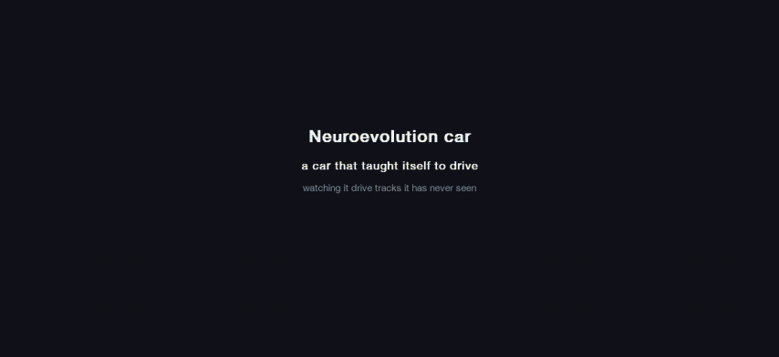
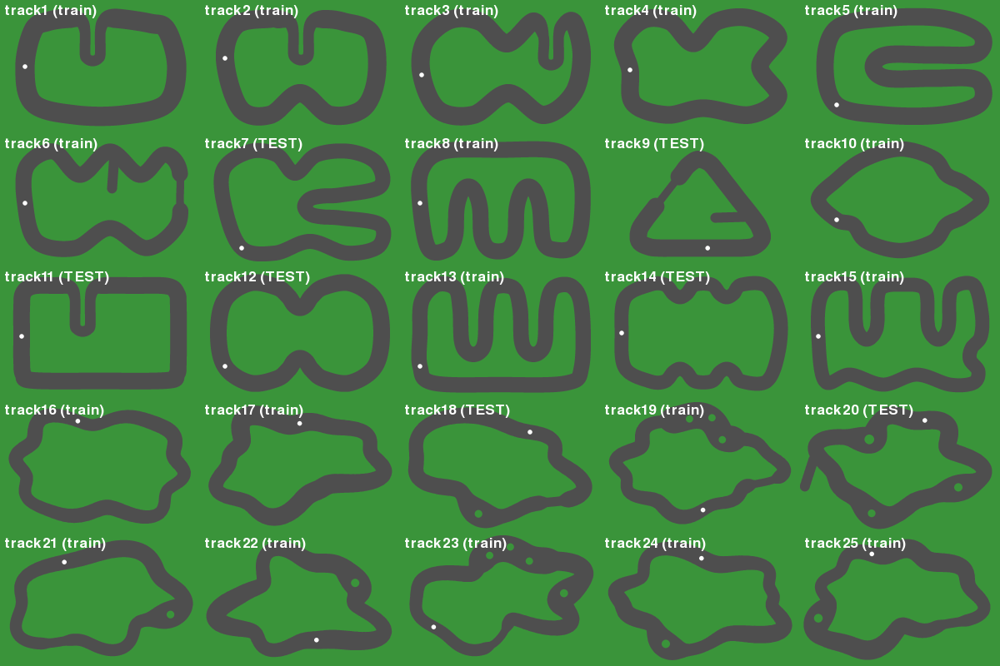
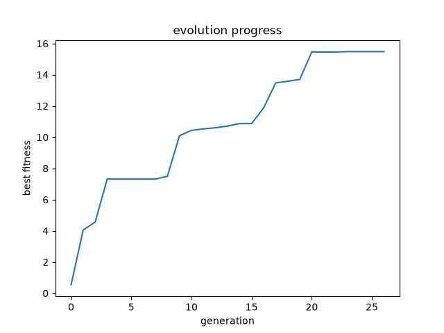
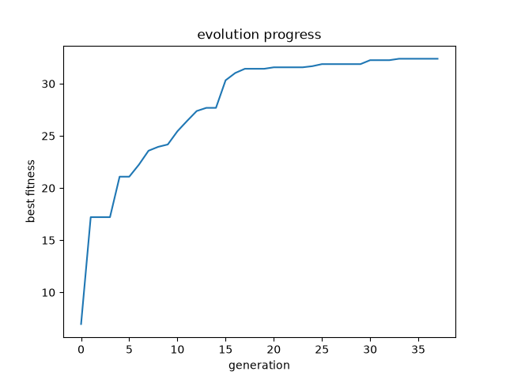
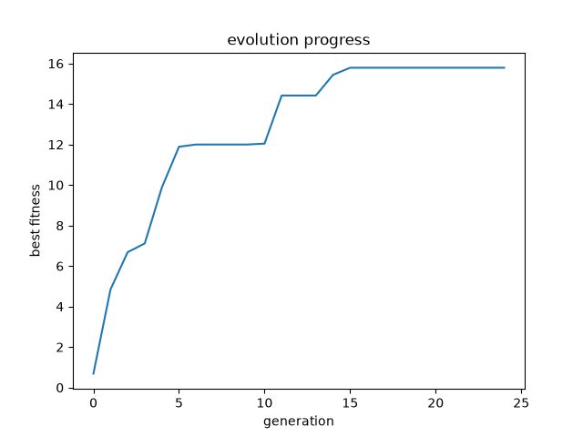
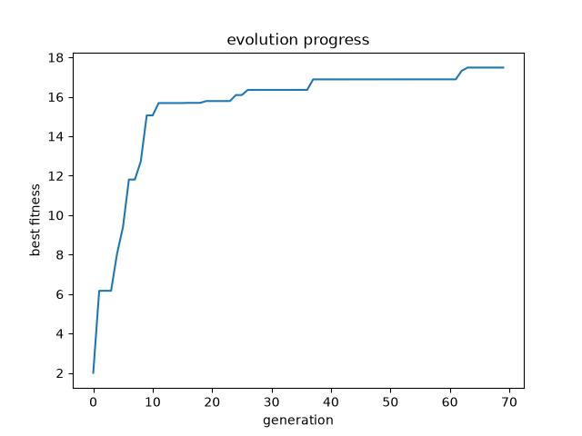

# Self-Driving Car: Neuroevolution from Scratch

A 2D top-down car learns to drive by itself. It sees the track through 7 distance "rays" plus its own speed, and a small neural network (8 → 8 → 2) turns those 8 numbers into steering and throttle. The network is never shown how to drive: it is trained by **neuroevolution**, a genetic algorithm that keeps the best brains, mixes them, and mutates them, generation after generation.

No ML libraries are used. The neural network and the genetic algorithm are written by hand in Python and NumPy, and the game runs in pygame.



*The final brain driving two **test tracks it never saw during training**: track 7 (the hairpin the first version crashed on; it now brakes for it) and track 18 (a thin road plus a grass island to steer around). The rays are colored by distance (green = far, red = wall close), the blue line is its path, and gates turn green as they're passed. The panel on the right shows the neural network deciding in real time: inputs → hidden neurons → steering and gas (orange = positive, blue = negative).*

## Results

**Final brain (run 4):**
- **Training tracks: 17 of 18** completed
- **Unseen test tracks: 5 of 7** completed

| Track | Set | Progress | Lap completed |
|---|---|---|---|
| 1 | train | 1.00 | ✅ |
| 2 | train | 1.00 | ✅ |
| 3 | train | 1.00 | ✅ |
| 4 | train | 1.00 | ✅ |
| 5 | train | 1.00 | ✅ |
| 6 | train | 1.00 | ✅ |
| 7 | **test** | 1.00 | ✅ |
| 8 | train | 1.00 | ✅ |
| 9 | **test** | 0.29 | ❌ |
| 10 | train | 1.00 | ✅ |
| 11 | **test** | 1.00 | ✅ |
| 12 | **test** | 1.00 | ✅ |
| 13 | train | 1.00 | ✅ |
| 14 | **test** | 1.00 | ✅ |
| 15 | train | 1.00 | ✅ |
| 16 | train | 1.00 | ✅ |
| 17 | train | 1.00 | ✅ |
| 18 | **test** | 1.00 | ✅ |
| 19 | train | 0.47 | ❌ |
| 20 | **test** | 0.71 | ❌ |
| 21 | train | 1.00 | ✅ |
| 22 | train | 1.00 | ✅ |
| 23 | train | 1.00 | ✅ |
| 24 | train | 1.00 | ✅ |
| 25 | train | 1.00 | ✅ |

*Progress = how far around one lap the car got (1.00 = full lap).*



The 25 tracks range from simple loops to deliberately absurd ones: hairpins and braking pockets that are physically impossible to take at full speed, 46 px "needles" (the car is 25 px wide), slaloms, grass islands in the middle of the road, and dead-end "decoy" side roads.

## How it works

### The car
- Arrow-key physics, driven by the brain instead of a player: throttle changes speed (acceleration 0.06), friction keeps 98% of the speed each frame (so top speed is about 3 px/frame), and steering turns at most 2° per frame.
- **Crashes** use pixel-perfect masks: the rotated car image is checked against a mask of the grass.

### What the car senses (8 inputs)
- **7 rays** at 0°, ±30°, ±60° and ±90° from the car's heading. Each ray steps outward until it hits grass (max 200 px) and reports its distance divided by 200, so 0 means a wall is touching the car and 1 means nothing within range.
- **Its own speed**, divided by 3 (top speed), so it is also roughly 0 to 1.

### The brain (90 numbers)
```
8 inputs → 8 hidden neurons (tanh) → 2 outputs (tanh): steering, throttle
```
Each layer is one line of NumPy: `np.tanh(W @ inputs + b)`. Outputs are between −1 and 1: steering −1 is full left, +1 is full right; throttle +1 is full gas, −1 is full brake or reverse.

### Scoring a drive
- Each track has **checkpoints** (gates) placed every ~150 px. They must be passed **in order**, so spinning in circles or driving backwards earns nothing.
- **Progress** on a track = (gates passed + how far the car got toward the next gate) ÷ total gates, capped at 1 lap.
- A car stops when it finishes a lap, crashes, or makes no progress for 800 frames. Each track allows 3,000 frames.

### Evolution
- 50 cars per generation, each with its own brain. Every generation drives **all 18 training tracks**, one after another.
- Cars are **ranked by priority**, not by one combined number: first **tracks completed**, then **total progress**, then **speed** on completed tracks. So finishing more tracks always beats being faster, and among equal finishers the faster one wins.
- The **top 10** become parents. The **best brain is copied unchanged** (elitism, so the best score can never go down). The other 49 children are made by **crossover** (each weight comes from parent A or parent B, a coin flip per weight) followed by **mutation** (every weight nudged by a random amount up to ±0.1).

## How to run it

```bash
pip install -r requirements.txt

python3 main.py       # train from scratch; press D to toggle drawing (off = much faster training)
python3 evaluate.py   # run the saved brain (models/best_brain_v2.pkl) on all 25 tracks and print the results
```

Training saves the best brain to `models/best_brain_v2.pkl` after every generation (so a new training run overwrites the included brain) and saves a best-fitness-per-generation chart to `docs/fitness_latest.png` when you close the window.

## What happened: four runs, three traps

The most interesting part of this project was not the final number but **why** each version failed and what fixed it.

### Run 1: 5 training tracks: generalizes, but never brakes


The brain reached the fitness ceiling on 5 training tracks (it never crashed and drove at ~2.95 of a 3.0 max speed). On 3 unseen tracks it **passed 2**. It failed the third (what is now **track 7**) at a tight hairpin.

**Why:** it never braked, because it never had to. It found full-speed racing lines through every training bend, so braking never earned a single extra point, and evolution never kept it. *A model only learns the skills its training data demands.*

### Run 2: 18 harder tracks, no lap cap: the "full-send" trap


I added tracks with **braking pockets**, narrow hairpins that were proven physically impossible at full speed: a robot driver that never brakes crashes there, and one that slows down finishes. The brain still never learned to brake. It plateaued at ~32 by lapping the 10 easy tracks 2–3 times each at full speed and writing off the hard ones (braking on under 1% of frames).

**Why:** the score counted extra laps. A mutant that started braking lost laps on 10+ easy tracks long before its braking was good enough to finish a pocket, so every braking mutant was thrown away. This is a **deceptive fitness landscape**: the score rewarded the wrong thing more than the right thing.

### Run 3: cap each track at 1 lap: it learns to brake, then "parks"


With each track capped at 1 lap, extra speed on easy tracks earned nothing, so braking was no longer punished. The brain learned **targeted braking**: about 45 frames of braking per lap, only at the pockets. It finished all braking-pocket tracks, and on the test set it **passed track 7**, the exact track that failed in run 1. Test score: **4 of 7**.

New problem: on tracks with grass islands it **parked**: speed 0, steering 0, throttle 0, about 66 px in front of the island, forever.

**Why:** (1) it couldn't sense its own speed, so "parked" and "rolling" looked identical; its throttle acted like a thermostat on the ahead-ray and settled exactly where gas = 0; (2) a centered island looks the same on the left and right, so steering came out as 0; (3) parking scored exactly the same as trying to get around.

A side effect of the cap: the cars also became slow and cautious, since speed no longer earned anything.

### Run 4 (final): speed input, 7 rays, partial credit, priority ranking


Each change targets one diagnosed cause:

| Change | Fixes |
|---|---|
| Speed as an input | the parking trap: it can learn "I'm stopped, so go", and brake relative to its speed |
| 7 rays instead of 5 | the ±30° rays pass beside an island and show which side is open |
| Partial credit toward the next gate | creeping around an obstacle now scores more than parking |
| Ranking by priority (completed → progress → speed) | speed matters again, but can never outrank finishing more tracks, so neither trap returns |

Result: **no more parking anywhere.** Islands are solved, **17 of 18** training tracks and **5 of 7** unseen tracks are completed.

### The one-sentence summary
> The brain can only learn what it can **sense**, what the **tracks demand**, and what the **score rewards**. Every failure in this project was one of those three missing, and every fix added the missing one.

## Where it still fails, and why

- **Track 9 (test), needle + decoy: 29%.** It crashes exactly at the junction where a dead-end decoy road branches off. From 7 rays, a dead end looks just like real road until it is too late; it has no memory and no way to know which opening is the real track.
- **Track 20 (test), decoy + 3 islands: 71%.** Much better than run 3 (12%), but the combination of a decoy and several obstacles is still too much.
- **Track 19 (train), slalom + needle: 47%.** The hardest training track; it now tries to weave instead of parking, but crashes.

## Honest limitations

- **One run per setting.** Evolution involves a lot of luck, so a proper comparison would repeat each run with several random seeds and report averages. These results are suggestive, not statistically proven.
- **Small scale:** 50 cars and a 90-number brain. A bigger population or network might do better (in commonLuke's video, the only brain with 2 hidden layers was also the only one to finish an unseen track with an obstacle).
- **Partial credit uses straight-line distance**, so a car can look "close" to the next gate across a thin strip of grass. It is worth less than one gate, but it is a known flaw.
- **The test split was hand-adjusted** (one test track per type of challenge, every tested skill present in training) after a first stratified random split; it was then locked before runs 2–4 and never changed based on results.

## How this project was built

This was a learning project. I started learning Python and ML from zero shortly before it (my first project was a Q-learning maze agent), and used an AI (Claude) as a mentor that explained concepts, asked questions, and reviewed my code instead of writing it.

- **Written by me:** the game, car physics, rays, crash detection, checkpoints and scoring, the neural network, the genetic algorithm (selection, elitism, crossover, mutation), the training loop, the evaluation script, and every fitness change (with guidance).
- **Generated by the AI, at my request:** the 25 track images and their checkpoint data (`assets/tracks/`), the scripts used to validate them (unskippable gates, drivable paths, robot-driver tests), the ray speed-up (coarse-then-fine stepping, about 5× faster) and the "no progress" stop in `car.py`, the demo GIF, and the first draft of this README.
- **Inspired by:** commonLuke's video [*Can I Make a Better AI Than AI?*](https://www.youtube.com/watch?v=GGWHjAyKJCA).

## Future work

- A larger brain (more hidden neurons, or a second hidden layer)
- More training tracks with decoys, the main remaining weakness
- Repeat each run with several random seeds and report averages
- A second training stage starting from the final brain, rewarding speed more strongly once every track can be completed
- Compare against a gradient-based method (for example DQN with PyTorch)

## Project files

| File | What it does |
|---|---|
| `main.py` | training: population, rounds over the training tracks, ranking, breeding, saving, plotting |
| `evaluate.py` | runs the saved brain once on every track and prints the results |
| `car.py` | the `Car` class: physics, rays, crash detection, checkpoints, progress |
| `brain.py` | the neural network (`create_brain`, `think`) and evolution operators (`mutate`, `crossover`) |
| `assets/tracks/` | 25 track images and `tracks.json` (start position, angle, checkpoints, train/test set) |
| `assets/car_red.png` | the car sprite |
| `models/best_brain_v2.pkl` | the final trained brain (the one in the results above) |
| `docs/` | the demo GIF, the fitness charts for each run, and an overview of all tracks |
| `roadmap.md` | the milestone plan and the end goal I set before starting |
